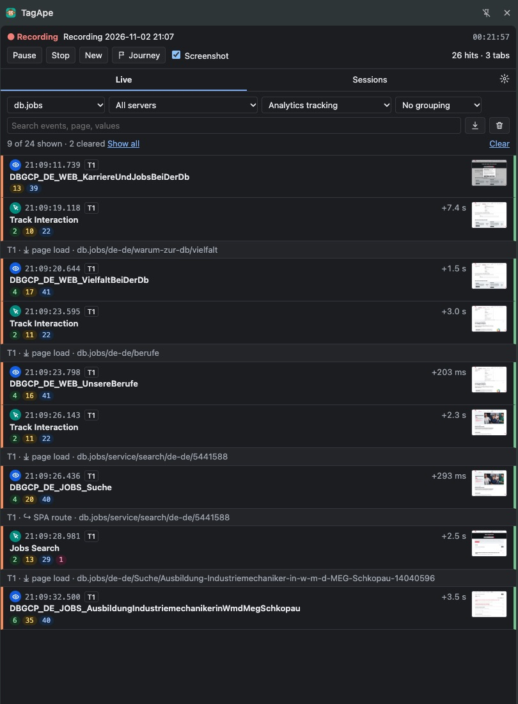
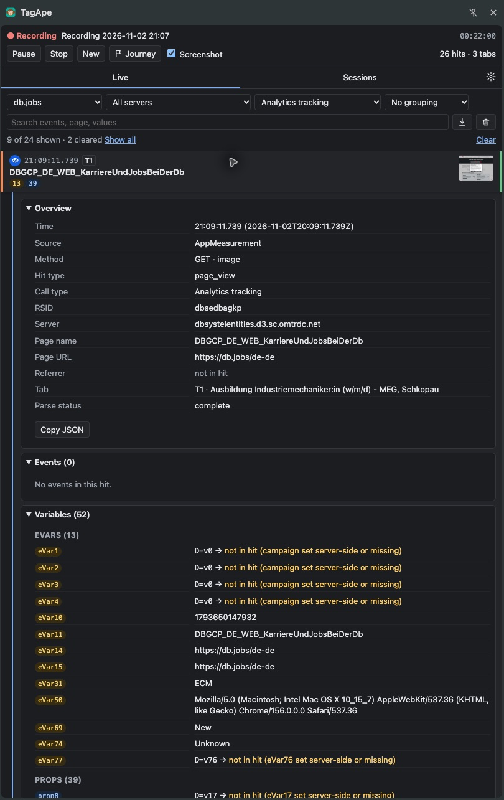
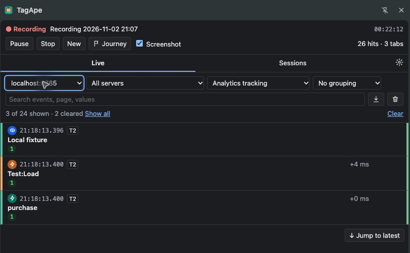
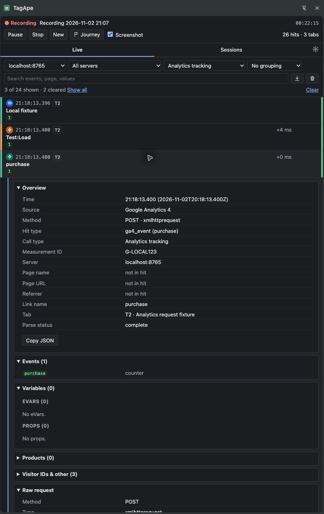
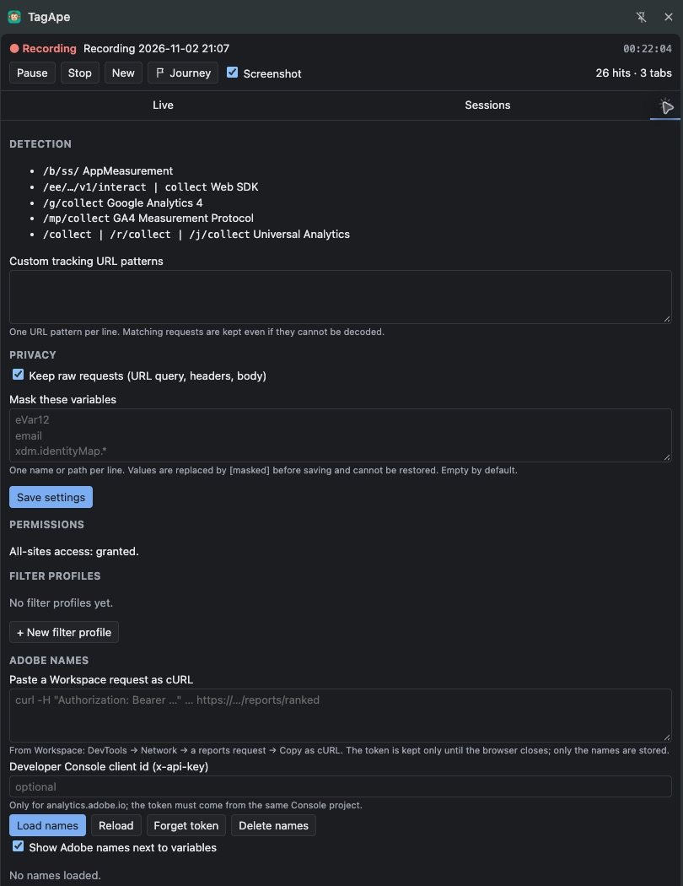

# TagApe

A Chrome Manifest V3 extension for inspecting tracking requests while you browse. It records hits across tabs in a side panel, decodes supported Adobe and Google Analytics formats, and keeps sessions in the local browser profile. DevTools does not need to stay open.

## Supported requests

| Source | Detection | Decoded fields |
| --- | --- | --- |
| Adobe AppMeasurement | `/b/ss/` | RSID, page and link details, events, eVars, props, lists, hierarchies, products, context data, visitor IDs |
| Adobe Web SDK | `/ee/.../vN/interact` or `/collect` | Datastream ID, batched events, XDM, Adobe Analytics data, page and link details |
| Google Analytics 4 | `/g/collect` with `v=2` and `tid=G-...` | Measurement ID, event name, page title/location/referrer, client and session IDs, remaining parameters |
| GA4 Measurement Protocol | `/mp/collect` with `measurement_id=G-...` | Events from a browser-visible JSON batch and their parameters |
| Universal Analytics | `/collect`, `/r/collect`, `/j/collect` with `v=1` and `tid=UA-...` | Tracking ID, hit type, page fields, event category/action/value, remaining parameters |
| Custom URL pattern | User-defined URLPattern | Query and available body shown generically when no built-in parser applies |

Requests fired through Google Tag Manager appear under their destination source above. The `gtm.js` container script is not a tracking hit. Other vendors can be added as custom URL patterns, but their payloads are not vendor-decoded.

## Features

- **Background recording:** Start, pause, resume, stop, or start a new session. Capture continues when the side panel is closed and spans normal tabs in the profile.
- **Live timeline:** See request time, source, hit type, tab, event/page label, parse warnings, and time since the preceding shown hit. Page loads and SPA route changes appear as separators.
- **Hit inspector:** Expand a hit to see decoded fields, remaining parameters, request URL, available headers and body, and observed response status or network error. Copy a hit as JSON.
- **Views and filters:** Limit by page host, tracking server, call type, journey, search text, or saved include/exclude rules. Group by tab, page, or journey. Clear the Live view without deleting stored hits.
- **Journeys and variables:** Mark and rename journey segments. Pin selected events or dimensions above the list; add favorites as columns on every row.
- **Sessions and exports:** Reopen and rename saved sessions; export a whole session as JSON or CSV. Export the currently shown journey as a standalone HTML report.
- **Optional screenshots:** While recording, capture the visible tab on clicks and key presses. Screenshots are stored with the session and can be viewed beside hits.
- **Privacy controls:** Mask named parameters before storage, or turn off raw request retention. GA4 Measurement Protocol `api_secret` is always masked. Delete one session or all recordings locally.
- **Optional Adobe names:** Paste a Workspace request as cURL to load dimension and metric names on demand. The bearer token is kept in browser session storage; names are stored locally.

## Screenshots

Live timeline with navigation boundaries and captured hits:



Expanded hit with decoded fields and request details:



GA4 and Universal Analytics requests captured from a local test page:



GA4 hit details and the detection and privacy settings:




## Install and use

1. Open `chrome://extensions` in Chrome 116 or newer and enable **Developer mode**.
2. Choose **Load unpacked** and select the `extension/` directory in this repository.
3. Pin **TagApe** if useful, then click its toolbar icon to open the side panel.
4. Press **Start recording** and browse the site you want to inspect. Open a hit for its decoded fields and raw request.
5. Use **Sessions** to reopen or export recordings. After changing local source files, press **Reload** on the extension card in `chrome://extensions`.

The extension requests access to all sites because tracking requests may use first-party hosts on any domain. It uses `webRequest` to observe requests, `webNavigation` for page boundaries, `storage` and IndexedDB for local data, and `sidePanel` for the UI. It does not modify or block requests. The optional Adobe name lookup is the only extension-initiated external API call.

## Limits and data handling

- Only requests visible to Chrome in the profile are captured. Server-to-server Measurement Protocol calls are not visible. Incognito requires enabling the extension there.
- Chrome does not expose response bodies through `webRequest`. Some POST or beacon bodies may also be unavailable; those hits are marked partial and retain the visible URL.
- Detection requires the supported path and version/ID fields. Custom first-party paths need a custom pattern; matching custom requests are shown generically.
- Recording data remains in this browser profile until deleted. Screenshots can contain page content. Raw URLs, headers and bodies may contain personal data; set masking rules or disable raw retention before recording sensitive pages. Cookie and authorization headers are never saved.
- A recorded request proves that the browser sent it, not that a reporting property processed it. Check the request result and the destination's reporting tools when delivery matters.

## Development

Requires Node.js 22.13 or newer. Run `npm install` once, then:

```sh
just check   # lint, manifest and parser checks, dependency and project checks
just build   # package extension/ as a ZIP in dist/
```

`just --list` shows the other recipes. The extension itself is plain HTML, CSS and JavaScript with no runtime package dependencies.
